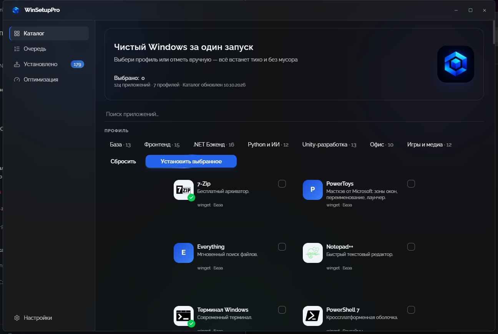
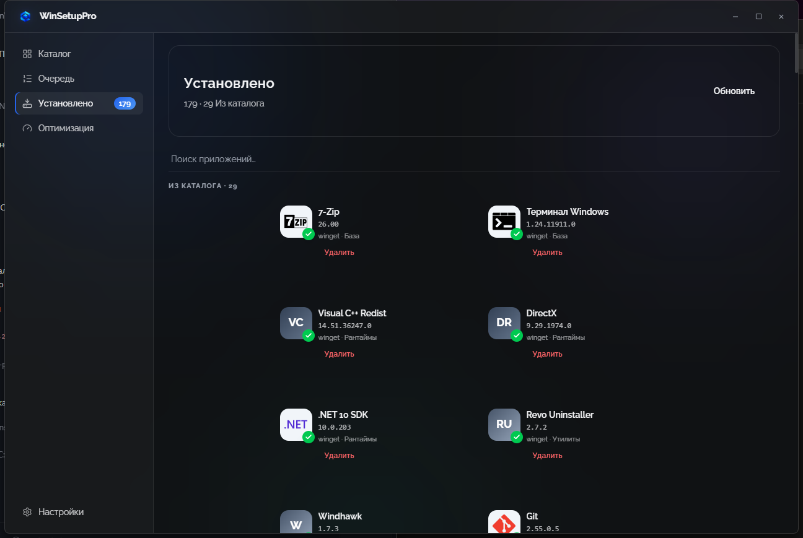
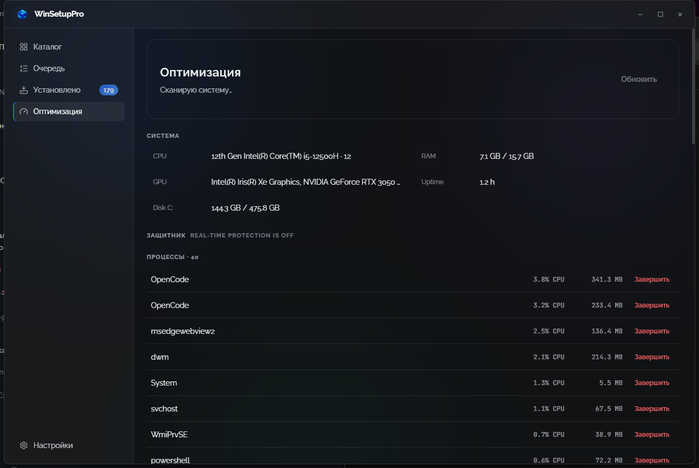
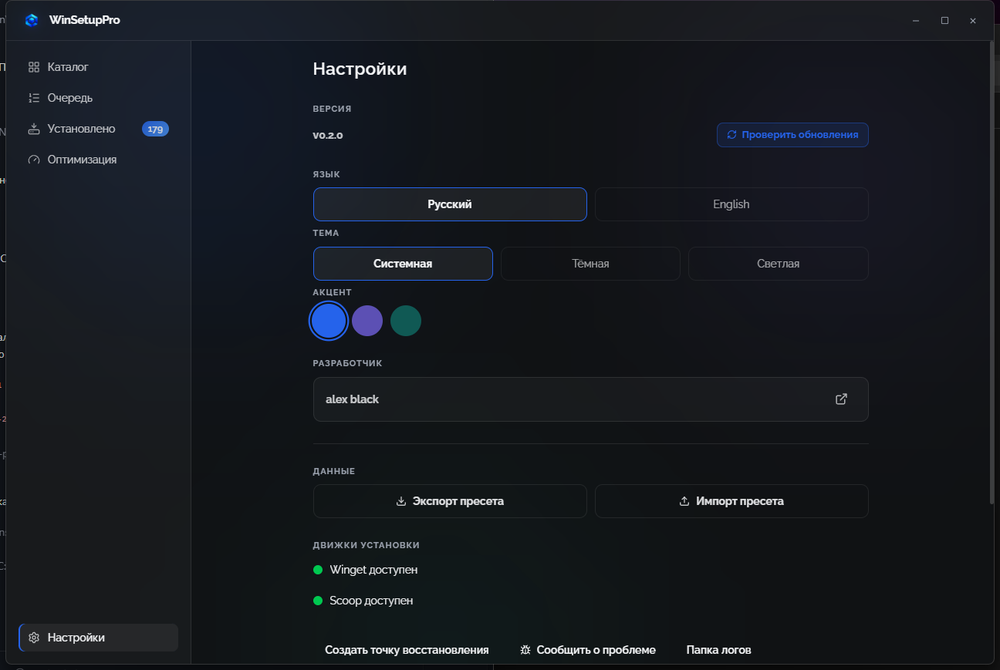

# WinSetupPro

Чистая установка софта на свежий Windows за один запуск. Выбери профиль (База, Фронтенд, .NET, Python/ИИ, Unity, Офис, Игры) или отметь приложения вручную — всё встанет тихо, официально и без мусора.

## Скриншоты






Clean software setup for fresh Windows in one run. Pick a profile or select manually — everything installs silently from official vendor binaries. RU/EN UI.

## Стек

- **Tauri 2 + React 19 + TypeScript + Vite + Zustand** — нативное окно (WebView2), крошечный бинарь, hot-reload
- **Rust-бэкенд**: winget/scoop-движки, последовательная очередь со стримингом логов, каталог, настройки, точка восстановления
- Дизайн-система в духе Spire: CSS-переменные, рантайм-акцент (blue/violet/teal), кастомный TitleBar, JetBrains Mono + Inter, lucide-иконки, framer-motion, тосты
- Каталог: `catalog/catalog.json` — 124 приложения, 7 профилей, 82 бренд-иконки локально
- Оптимизатор: анализатор ПК (железо, процессы, автозагрузка, Defender-гигиена, мусор), полное удаление в духе Revo, 5 обратимых твиков

## Почему это чисто

- Только `winget` (основное) + `scoop` (CLI-утилиты): официальные установщики вендоров, hash-проверка манифестов
- Флаги: `--silent --disable-interactivity --accept-package-agreements`. Никаких репаков, тулбаров и «попутных» программ
- Уже установленное пропускается, очередь строго последовательна
- Перед массовой установкой создаётся точка восстановления (best-effort)

## Разработка

```powershell
# Требования: Node 20+, Rust stable + MSVC, WebView2 (есть в Win11)
cd desktop
npm install
npm run tauri dev     # запуск с hot-reload
npm run build         # tsc && vite build
npm run lint          # eslint, 0 ошибок
npm run test          # vitest
# Rust-тесты движка:
cargo test --manifest-path src-tauri/Cargo.toml
```

GUI запускается **без прав админа** (иначе WebView2 не стартует); для самой установки приложение попросит перезапуск как админ.

Пресеты: `%AppData%\WinSetupPro\settings.json`. Свой каталог: `%AppData%\WinSetupPro\catalog.json` (+ `icons/` рядом) — перекроет встроенный.

IT-режим: `WinSetupPro.exe --preset team.json` — id из пресета добавляются в выборку до старта GUI.

## Решения и компромиссы

- Очередь строго последовательна: параллельные MSI портят состояние системы.
- Удаление только тихими движками (winget/scoop/MSI); произвольные EXE-деинсталляторы не запускаются скрытно.
- Реестр правится только в allowlist-ветках; автозагрузка бэкапится в `%AppData%\WinSetupPro\backups\` перед отключением.
- Эвристика процессов — гигиена, а не антивирус: сигнатурного движка нет осознанно.
- Разгона частот нет осознанно: только схема питания, игровой режим, визуал — безопасное и обратимое.
- Версия едина: `Cargo.toml` = `tauri.conf.json` = `package.json` = `version.ts`, рассинхрон ловит тест.

## Поддержка

| Окружение | Статус |
|---|---|
| Windows 11 | поддерживается |
| Windows 10 21H2+ | поддерживается |
| Windows старее 21H2 | не поддерживается — обновитесь |
| winget из коробки | требуется (есть в Win11 и свежих Win10) |

## Защита (честно)

Open-source (MIT). Уровень: честный — официальный репозиторий, подписанные релизы и hash-проверка winget. 100% защиты от реверса не существует.

## История

- v0.1 — прототип на WinUI 3 + .NET 10 (сохранён в git-истории). Переход на Tauri ради скорости UI-разработки и качества интерфейса.
- v0.2 — Tauri + React: движок портирован на Rust 1-в-1, добавлены тосты, выбор акцента, кастомный TitleBar.
